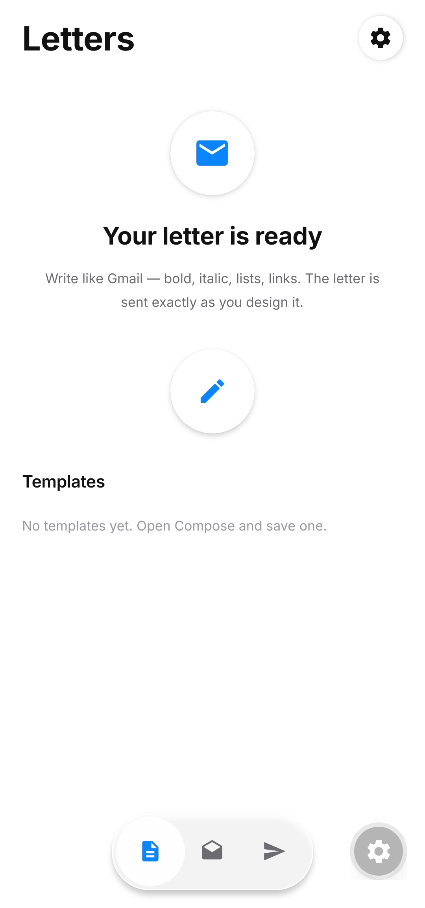
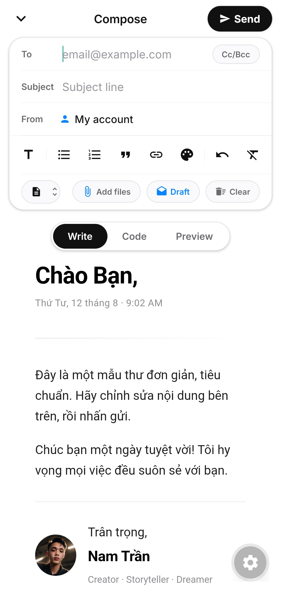
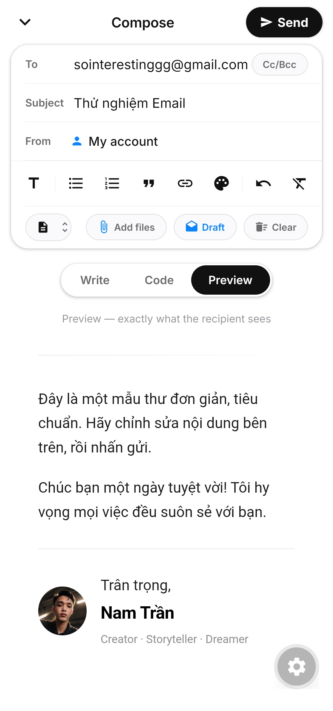
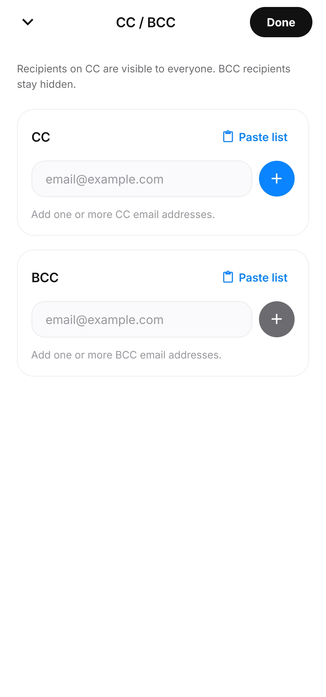
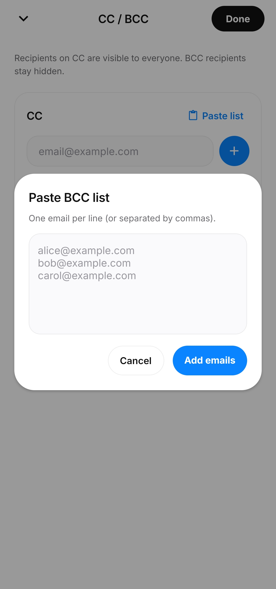
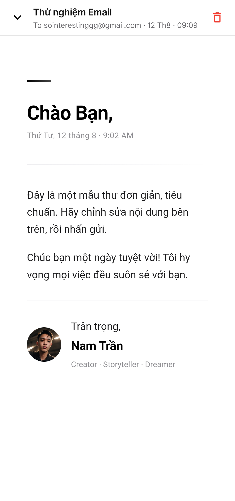
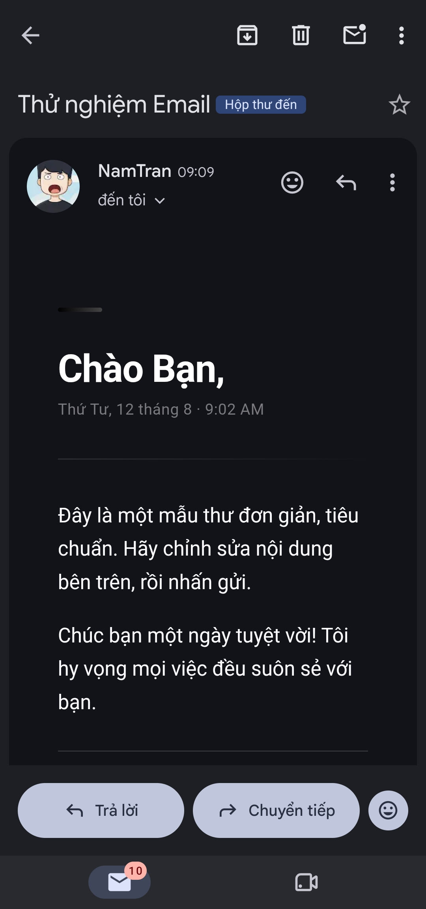

# Email Sender

**Soạn và gửi email chuyên nghiệp, tiện lợi ngay trên điện thoại — đẹp hơn hẳn thư văn bản thông thường.**

Email Sender là ứng dụng Android giúp bạn soạn **email HTML dạng thư tay** với giao diện soạn thảo rich text mượt mà: in đậm, nghiêng, gạch chân, danh sách, trích dẫn, link, màu chữ. Mỗi bức thư được tinh chỉnh chính xác từng chi tiết, xem trước đúng những gì người nhận sẽ thấy rồi mới gửi đi — một giải pháp gọn gàng, chuyên nghiệp thay cho những email trống trơn, đơn điệu.

## Ảnh chụp màn hình

| Trang chủ | Soạn thư | Xem trước |
| :-: | :-: | :-: |
|  |  |  |

| Cc / Bcc | Danh sách Cc / Bcc | Thư đã gửi |
| :-: | :-: | :-: |
|  |  |  |

| Thư nhận được |
| :-: |
|  |

## Tính năng

- **Soạn thư rich text** với 3 chế độ: **Write** (soạn trực quan), **Code** (paste HTML tuỳ chỉnh, highlight như VSCode), **Preview** (xem đúng định dạng người nhận).
- **Nhiều tài khoản SMTP**: thêm / sửa / xoá, chọn tài khoản mặc định, test kết nối trước khi lưu.
- **Mẫu (Templates)**: tạo mẫu HTML riêng, đặt mẫu mặc định, dùng lại cho thư mới.
- **Nháp tự động**: thư đang soạn được lưu tự động, khôi phục khi bấm vào nháp trong tab Drafts.
- **Thư đã gửi (Sent)**: lịch sử thư đã gửi, xem lại nội dung, xoá.
- **CC / BCC**: thêm nhiều địa chỉ, dán danh sách email hàng loạt.
- **Đính kèm**: chọn tài liệu từ máy.
- Giao diện trắng – đen điểm vàng ánh kim, dùng font **Inter**.

## Công nghệ

- [Expo SDK 57](https://docs.expo.dev/versions/v57.0.0/) + React Native
- `@react-navigation` (native-stack + bottom-tabs)
- `react-native-tcp-socket` — SMTP client trực tiếp từ app
- `react-native-webview` — hiển thị nội dung thư
- `@react-native-async-storage/async-storage` — lưu cấu hình, nháp, thư đã gửi
- `expo-document-picker`, `expo-file-system` — đính kèm tệp

## Chạy thử

Vì app dùng module native (`react-native-tcp-socket`), **không chạy được trong Expo Go** — cần build bằng dev client:

```bash
cd app
npm install
npx expo prebuild --platform android
npx expo run:android
```

Hoặc build APK bằng EAS:

```bash
cd app
npx eas-cli build --platform android --profile preview
```

## Cấu hình SMTP

Vào **Settings** trong app, thêm tài khoản SMTP:

| Trường | Ví dụ |
| ------ | ----- |
| Host | `smtp.gmail.com` |
| Port | `465` (bật TLS) |
| Username | email của bạn |
| Password | App password (Gmail) |
| Sender name | tên hiển thị |
| Sender email | địa chỉ gửi |

Bấm **Test connection** để kiểm tra rồi **Save**.

## Cấu trúc

```
email-sender-app/
└── app/
    ├── App.js                     # Điều hướng gốc (Home / Compose / Settings)
    ├── src/
    │   ├── screens/               # Home (3 tab), Compose, Settings
    │   ├── components/            # RichEditor, Toolbar, TemplateLibrary, CcBccModal, ...
    │   ├── smtp.js                # SMTP client trực tiếp
    │   ├── smtpConfig.js          # Quản lý tài khoản SMTP
    │   ├── templates.js           # Quản lý mẫu
    │   ├── drafts.js              # Quản lý nháp
    │   ├── sent.js                # Lịch sử thư đã gửi
    │   └── emailHtml.js           # Dựng HTML thư
    └── assets/                    # Icon, splash
```
