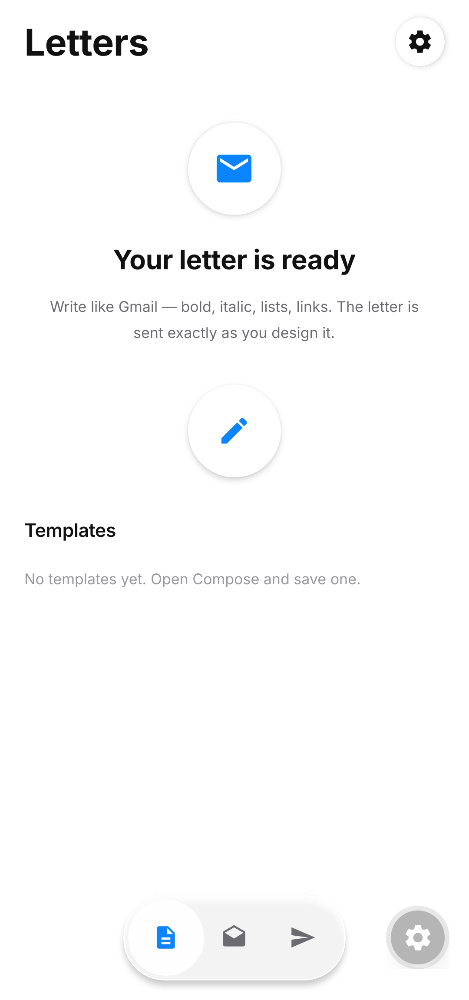
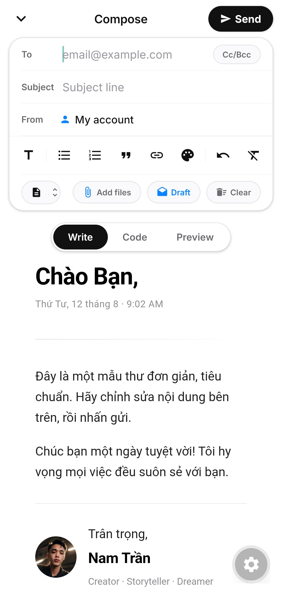
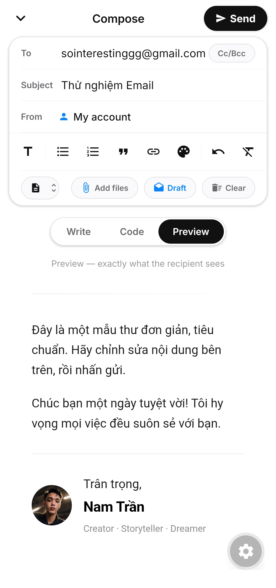
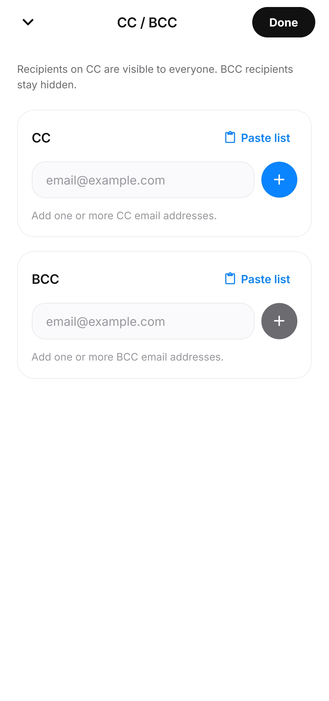
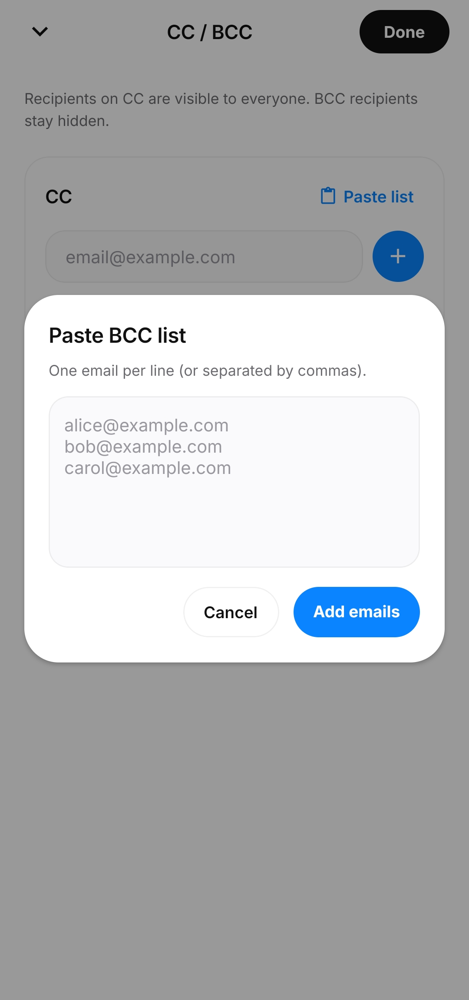
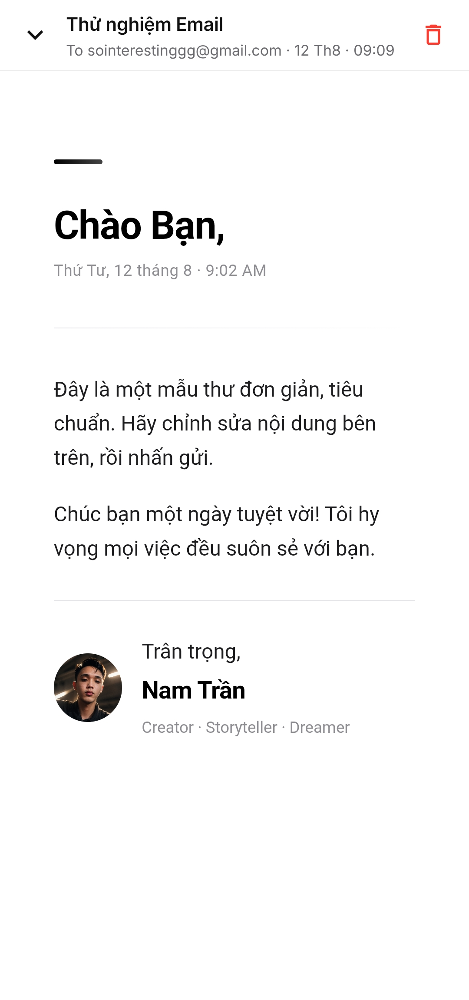
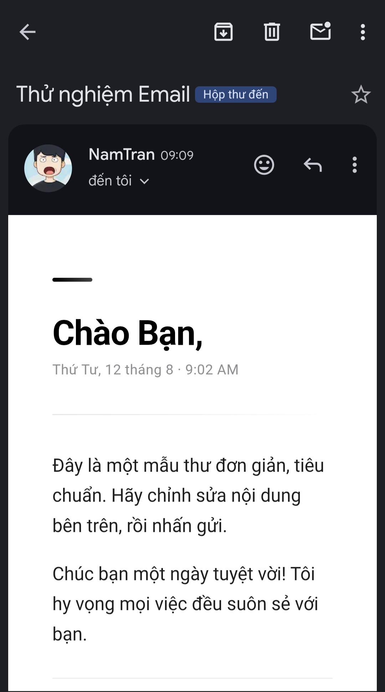
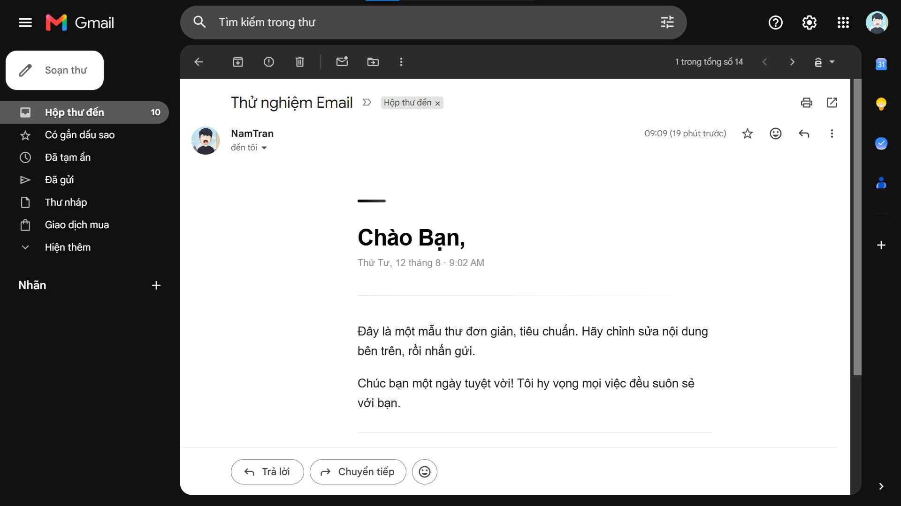

<div align="center">

# Email Sender

**Soạn và gửi email HTML đẹp, tiện lợi ngay trên điện thoại — không còn những thư văn bản trống trơn.**

[](https://expo.dev/)
[](#)
[](#)
[](#)
[](LICENSE)

[English](README.md) · **Tiếng Việt**

</div>

---

## Ảnh chụp màn hình

| Trang chủ | Soạn thư | Xem trước |
|:--:|:--:|:--:|
|  |  |  |

| Cc / Bcc | Danh sách Cc / Bcc | Chi tiết thư đã gửi |
|:--:|:--:|:--:|
|  |  |  |

| Thư người nhận nhận được trên mobile | Thư người nhận nhận được trên máy tính |
|:--:|:--:|
|  |  |

---

## Giới thiệu

Email Sender là ứng dụng Android giúp soạn email HTML với trình soạn thảo rich text. Ứng dụng hỗ trợ in đậm, nghiêng, gạch chân, danh sách, trích dẫn, liên kết và màu chữ, đồng thời có trình sửa HTML thô và màn hình xem trước chính xác trước khi gửi.

Ứng dụng kết nối SMTP trực tiếp bằng `react-native-tcp-socket`, nên không cần máy chủ trung gian hay dịch vụ chuyển tiếp email.

---

## Tính năng

- **Soạn thư rich text** với ba chế độ:
  - **Write** — soạn trực quan
  - **Code** — nhập HTML tuỳ chỉnh
  - **Preview** — xem đúng định dạng người nhận thấy
- **Nhiều tài khoản SMTP** — thêm, sửa, xoá, chọn tài khoản mặc định và kiểm tra kết nối trước khi lưu
- **Mẫu email** — tạo mẫu HTML dùng lại, đặt mẫu mặc định và bắt đầu thư mới từ mẫu
- **Nháp tự động** — thư đang soạn được lưu tự động và khôi phục từ tab **Drafts**
- **Thư đã gửi** — xem lại nội dung đã gửi và xoá lịch sử
- **Cc / Bcc** — thêm nhiều địa chỉ, dán danh sách email hàng loạt
- **Đính kèm tệp** — chọn tài liệu từ thiết bị
- **Tab trang chủ** — Templates, Drafts và Sent
- **Cài đặt** — quản lý tài khoản SMTP và xoá toàn bộ dữ liệu cục bộ
- Giao diện trắng – đen với điểm nhấn vàng ánh kim, dùng font **Inter**

---

## Công nghệ

| Thành phần | Sử dụng |
|:--|:--|
| Framework di động | Expo SDK 57 + React Native 0.86 |
| Ngôn ngữ | JavaScript (JSX), React 19 |
| Điều hướng | React Navigation native-stack + bottom-tabs |
| SMTP transport | `react-native-tcp-socket` (SMTP client trực tiếp từ ứng dụng) |
| Xem trước email | `react-native-webview` |
| Lưu trữ cục bộ | `@react-native-async-storage/async-storage` |
| Chọn tệp đính kèm | `expo-document-picker`, `expo-file-system` |
| Giao diện | Font Inter, Expo vector icons, theme tự dựng |

---

## Yêu cầu môi trường

- **Node.js 20+** (khuyến nghị) và **npm 10+**
- **Android Studio** để build Android cục bộ
- Thiết bị Android hoặc máy ảo Android
- **Expo CLI** qua `npx expo`
- Nếu build APK bằng EAS: tài khoản **Expo / EAS** và EAS CLI (`eas build`)

> Vì ứng dụng dùng module native `react-native-tcp-socket` nên **không chạy trong Expo Go**. Hãy dùng Expo dev client hoặc bản build EAS.

---

## Cách chạy

```bash
git clone https://github.com/Namtran592005/Email-Sender.git
cd Email-Sender/app

npm install
```

### Chạy bằng dev client

```bash
npx expo prebuild --platform android
npx expo run:android
```

Hoặc khởi động dev client server:

```bash
npm start
```

### Build APK bằng EAS

```bash
npx eas-cli build --platform android --profile preview
```

`eas.json` định nghĩa các profile:

| Profile | Mục đích |
|:--|:--|
| `development` | Bản internal, bật development client |
| `preview` | APK Android cho kiểm tra nội bộ |
| `production` | APK Android production |

---

## Cấu hình SMTP

Mở **Settings** trong ứng dụng và thêm tài khoản SMTP.

| Trường | Ví dụ |
|:--|:--|
| Host | `smtp.gmail.com` |
| Port | `465` và bật TLS |
| Username | Địa chỉ email của bạn |
| Password | App password của Gmail |
| Sender name | Tên hiển thị |
| Sender email | Địa chỉ gửi |

Dùng **Test connection** để kiểm tra máy chủ, xác thực và thiết lập TLS/STARTTLS trước khi lưu.

SMTP client hỗ trợ:

- Implicit TLS (ví dụ cổng `465`)
- STARTTLS (ví dụ cổng `587` và `25`)
- `AUTH PLAIN`, dự phòng bằng `AUTH LOGIN`
- Header mã hoá UTF-8
- Email MIME multipart kèm tệp đính kèm
- Timeout phiên SMTP và phân tích phản hồi SMTP

---

## Dữ liệu cục bộ

Ứng dụng lưu mọi dữ liệu bằng AsyncStorage:

| Dữ liệu | Storage key |
|:--|:--|
| Tài khoản SMTP | `@email_sender/smtp_accounts` |
| Tài khoản SMTP mặc định | `@email_sender/smtp_default_id` |
| Nháp | `@email_sender/drafts` |
| Nháp đang sửa gần nhất | `@email_sender/last_draft_id` |
| Lịch sử đã gửi | `@email_sender/sent` |
| Mẫu tuỳ chỉnh | `@email_sender/custom_templates` |
| Mẫu mặc định | `@email_sender/default_template` |

Giới hạn trong mã nguồn:

- Nháp: **20** bản gần nhất
- Thư đã gửi: **60** bản gần nhất
- Tệp đính kèm mỗi thư: **12** tệp

> ⚠️ Mật khẩu SMTP được lưu trong AsyncStorage trên thiết bị. Phù hợp cho ứng dụng cá nhân, nhưng không nên dùng trên thiết bị dùng chung hoặc không đáng tin cậy.

---

## Cấu trúc dự án

```text
.
├── app/                          # Ứng dụng Expo / React Native
│   ├── App.js                    # Điều hướng gốc, font, splash/fade-in
│   ├── app.json                  # Cấu hình Expo và tên package Android
│   ├── eas.json                  # Profile build EAS
│   ├── index.js                  # Native entry point
│   └── src/
│       ├── screens/              # Home, Compose, Drafts, Sent, Settings, Templates
│       ├── components/           # RichEditor, Toolbar, TemplateLibrary, CcBccModal, ...
│       ├── smtp.js               # SMTP client trực tiếp
│       ├── smtpConfig.js         # Lưu tài khoản SMTP
│       ├── templates.js          # Lưu mẫu
│       ├── drafts.js             # Lưu nháp
│       ├── sent.js               # Lưu lịch sử đã gửi
│       ├── emailHtml.js          # Dựng HTML thư
│       ├── clearData.js          # Xoá toàn bộ dữ liệu cục bộ
│       └── theme.js              # Bảng màu, font, spacing, shadow
├── Screenshots/                  # Ảnh chụp ứng dụng
├── LICENSE                       # GNU General Public License v3.0
├── README.md                     # Tài liệu tiếng Anh
└── README.vi.md                  # Tài liệu tiếng Việt
```

---

## Luồng sử dụng

1. Nếu chưa cấu hình tài khoản SMTP, ứng dụng mở **Settings** trước.
2. Sau khi cấu hình xong, **Home** hiển thị ba tab:

   | Tab | Mục đích |
   |:--|:--|
   | Templates | Tạo và dùng lại mẫu email |
   | Drafts | Tiếp tục thư đang soạn |
   | Sent | Xem lại thư đã gửi |

3. **Compose** mở dưới dạng modal gồm trình soạn trực quan, trình sửa code và xem trước.
4. Người dùng chọn tài khoản SMTP, nhập người nhận, tiêu đề, nội dung và tệp đính kèm.
5. Sau khi gửi, ứng dụng ghi lại thư vào lịch sử Sent ngay trên thiết bị.

---

## Giấy phép

Dự án được cấp phép theo [GNU General Public License v3.0](LICENSE) (GPL-3.0).

Bản quyền © 2026 [@Namtran592005](https://github.com/Namtran592005).

Để sửa lỗi, góp ý hoặc hỏi về bản quyền: [@Namtran592005](https://github.com/Namtran592005).
